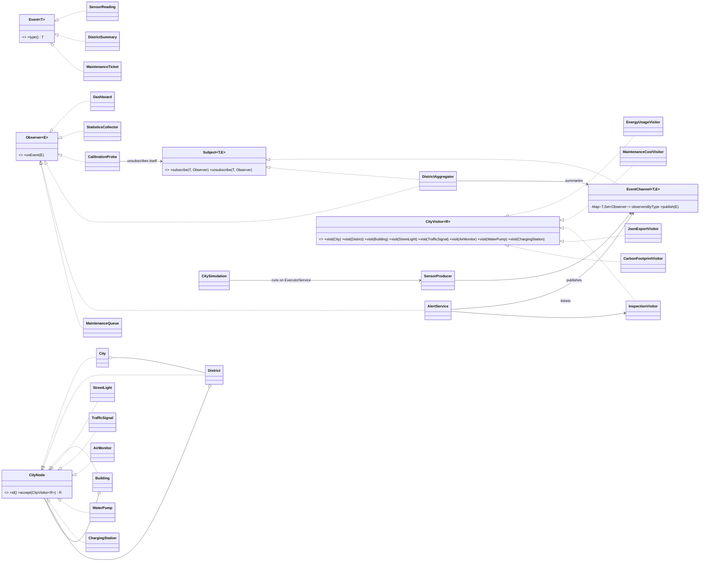

# CityPulse — Smart City Monitoring (Variant 1)

Observer + Visitor in plain Java 17. Sensor feeds notify listeners, a district aggregator republishes averages, and an alert runs an inspection visitor on the affected district only and publishes a maintenance ticket.

```
mvn test
java -cp target/classes citypulse.CityPulseApp [threads=3] [eventsPerProducer=1000]
```

## Structure

| Package | Contents |
|---|---|
| `observer` | `Event<T>`, `Observer<E>`, `Subject<T,E>`, `EventChannel<T,E>` (thread-safe registry) |
| `event` | Immutable records: `SensorReading`, `DistrictSummary`, `MaintenanceTicket`; enums `SensorType`, `TicketPriority` |
| `listener` | `Dashboard`, `StatisticsCollector`, `CalibrationProbe`, `DistrictAggregator`, `AlertService`, `MaintenanceQueue` |
| `city` | Composite tree: `City → District → Building → devices` and `CityVisitor<R>` |
| `visitor` | `EnergyUsageVisitor`, `MaintenanceCostVisitor`, `InspectionVisitor`, `JsonExportVisitor`, `CarbonFootprintVisitor` |
| `simulation` | `SensorProducer` (one per feed), `CitySimulation` (runs producers on an `ExecutorService`) |
| `CityPulseApp` | The only composition root |

## Design decisions

**Observer**
- Data sources: three `EventChannel<SensorType, SensorReading>` feeds (air: `PM25`, `NOISE`; traffic; water). `DistrictAggregator` and the ticket channel are further subjects.
- Subscription is per event type: `subscribe(type, observer)`. `publish` looks up only that type's set.
- Six listeners: `Dashboard` (latest value), `StatisticsCollector` (count/avg/min/max), `DistrictAggregator` (window averages), `CalibrationProbe` (unsubscribes itself from inside its handler after N samples), `AlertService`, `MaintenanceQueue`.
- Chain: readings → `DistrictAggregator` (observer *and* subject) → `DistrictSummary` → `AlertService` → `MaintenanceTicket` → `MaintenanceQueue`.
- **Push model.** Each event carries all its data as an immutable record. With several producer threads the subject's state changes constantly, so a pull model would read values that already belong to a later event. Push also keeps listeners decoupled from the subject's API.

**Visitor**
- Tree: `City` → `District` → `Building` → leaves, with leaves also allowed directly under a district (3 container types, 5 leaf types after the trade-off commit). Elements are records holding data plus the one-line `accept`.
- `CityVisitor<R>` uses overloaded `visit(...)`. Double dispatch: `node.accept(v)` selects the element's runtime type (1st dispatch), and inside `accept` the call `visitor.visit(this)` is resolved at compile time against the concrete `this` type (2nd dispatch). The client cannot call `visitor.visit(node)` with a `CityNode` reference, because overloads are resolved by the static type and there is no `visit(CityNode)`.
- Required visitors: numeric `EnergyUsageVisitor`; state-accumulating `MaintenanceCostVisitor` (tracks the enclosing district during the walk, so it is single-use); filter `InspectionVisitor` (returns the unhealthy devices); hand-written `JsonExportVisitor` (nesting and string escaping).
- **The visitor does the traversal.** Each operation needs different control: sum, flatten, track the enclosing district, or wrap children in `[...]` for JSON. The integration also visits a single district. If the elements did the traversal, they would carry logic and break the "data only" rule.

**Integration**
- `AlertService` receives a `DistrictSummary` above its threshold, runs `InspectionVisitor` on that `District` only, and publishes a `MaintenanceTicket` on the ticket channel: `URGENT` when faulty devices were found, `ROUTINE` otherwise.

**Concurrency**
- `EventChannel` uses a `ConcurrentHashMap<T, CopyOnWriteArraySet<Observer>>`. There is no lock on the subject: `publish` iterates a snapshot, so subscribing or unsubscribing (from any thread, or from inside a handler) never throws. An event that was already in flight can still reach an observer that unsubscribes concurrently; the next publish will not.
- Listener state uses `ConcurrentHashMap.merge/compute` with immutable values, atomics, `DoubleAdder` and `ConcurrentLinkedQueue`. `DistrictAggregator` closes each window inside `compute`, so every window is emitted exactly once. Publishing happens outside the map lock.
- `CitySimulation` takes an injected `ExecutorService` (thread count is configured in `CityPulseApp`, from `args[0]`). `invokeAll` waits for every producer, so no events are lost. A producer failure is rethrown. The executor is always shut down and awaited, and forced down after the timeout, so no threads are left running.

**Clean Code**
- One composition root (`CityPulseApp`), constructor injection only, all fields `final` except the visitor's traversal context, and no lazy initialization.
- `Subject` contains only subscription methods. `publish` belongs to the owner (`EventChannel`), so listeners cannot publish into a feed they only observe.

## UML



## Trade-off proof

| Commit | Files changed | Element classes touched |
|---|---|---|
| `Add carbon footprint visitor without touching element classes` | `visitor/CarbonFootprintVisitor.java` (new), `VisitorTest.java` | 0 |
| `Add charging station element type` | `city/ChargingStation.java` (new), `city/CityVisitor.java`, `EnergyUsageVisitor`, `MaintenanceCostVisitor`, `InspectionVisitor`, `JsonExportVisitor`, `CarbonFootprintVisitor`, `CityPulseApp.java`, `VisitorTest.java` | 1 new + the visitor interface |

**Cost.** A new operation is one new class, and the existing code stays closed to change (OCP holds for operations). A new element type changes the visitor interface and therefore every visitor. The cost grows linearly with the number of visitors, and the compiler forces every one of them to be updated. Visitor fits here because the device set is stable and new reports arrive often. If new device types arrived more often than new operations, or if visitors lived in other teams' modules, I would reject Visitor and put polymorphic methods on the elements, or use a sealed interface with pattern matching.

## Tests (21)

- `EventChannelTest`: per-type delivery, unsubscribe, subscribe inside a handler, and concurrent unsubscribe while 3 threads publish.
- `ListenerTest`: dashboard, statistics, self-unsubscribing probe, aggregator windows, alert → inspection → ticket for one district, and below-threshold summaries.
- `VisitorTest`: every visitor checked against hand-calculated values (870 W, 195/240 maintenance cost, 2.64 kg CO2, exact JSON strings including escaping), plus the new element.
- `CitySimulationTest`: stress test with 4 threads × 1,000 events, expecting exactly 4,000 readings and exactly 400 summaries, and the executor terminated; a failing producer is reported and the executor still shuts down.
